# H2Organize

User Experience Design for Rural Drinking Water Committee Management.

## Table of Contents

- [1. Introduction](#1-introduction)
  - [1.1. Problem](#11-problem)
  - [1.2. Solution](#12-solution)
  - [1.3. Team and Roles](#13-team-and-roles)
- [2. Strategy and Scope](#2-strategy-and-scope)
  - [2.1. UX Personas](#21-ux-personas)
  - [2.2. Value Proposition Canvas](#22-value-proposition-canvas)
  - [2.3. Customer Journey Map](#23-customer-journey-map)
  - [2.4. Benchmarking](#24-benchmarking)
- [3. Structure](#3-structure)
  - [3.1. Navigation Flow](#31-navigation-flow)
- [4. Layer Skeleton](#4-layer-skeleton)
  - [4.1 Main Dashboard](#41-main-dashboard)
  - [4.2 Member Directoy](#42-member-directory)
  - [4.3 Meter Readings](#43-meter-readings)
  - [4.4 Billing and Collections](#44-billing-and-collections)
  - [4.5 Issues and Reports](#45-issues-and-reports)

## 1. Introduction

### 1.1. Problem
Rural Drinking Water (APR - Agua Potable Rural) committees are vital, community-driven organizations responsible for extracting, treating, and distributing water in remote areas unserved by large utility companies. Operating as a state-supported public policy for over 60 years, there are currently more than 2,400 operational APR systems across Chile. These systems are much more than just infrastructure; they represent a fundamental pillar for health, equity, economic development, and social justice, providing essential water and sanitation access to over 2.2 million rural residents.

However, despite their massive scale and critical importance, the daily administration of these systems—including meter readings, billing, service cutoffs, assemblies, and tracking overdue payments—remains largely manual and paper-based, relying heavily on the efforts of volunteer local leaders.

Transitioning this outdated management system to a digital platform presents two distinct User Experience challenges:

* Disparate Digital Literacy: There is a technological gap between the committee board (administrators) and the cooperative members (consumers). Because many rural residents face digital illiteracy, any technological solution must drastically minimize friction and leverage familiar communication tools to ensure successful adoption.

* Social Data Sensitivity: In small, tight-knit localities, the design object is inherently collective. The way community information is handled and displayed has direct social consequences. The system must guarantee strict privacy so that sensitive data, such as a neighbor's overdue debts, is never exposed to the broader community.

### 1.2. Solution
H2Organizer is a digital management platform designed specifically to address the administrative and social realities of Rural Drinking Water (APR) committees. Our goal is to streamline the committee's workload while providing an accessible, friction-less experience for all community members, regardless of their digital literacy levels.

The proposed solution operates on two main fronts, supported by a familiar communication channel:

* Administrative Web Dashboard (For the Board): A centralized web platform that allows the committee leaders to easily manage daily operations. This includes tools for recording monthly meter measurements, maintaining an updated member directory, tracking overall water consumption, and generating billing statements efficiently.

* Private Member Portal (For the Community): A secure, simplified access point where individual members can view their personal consumption data and access a payment gateway. This ensures transparency and autonomy while strictly protecting each user's financial privacy from the rest of the community.

* Frictionless Notifications (WhatsApp Integration): To bridge the digital divide, H2Organizer will leverage WhatsApp as its primary notification system. Since WhatsApp is already the established and trusted tool for coordination in these rural communities, using it for automated alerts (such as new bills, payment reminders, or service updates) drastically reduces the learning curve and ensures critical information reaches everyone.

### 1.3. Team and Roles
* Francisco Lizama → Project Manager
* Gabriel Valenzuela → UX Researcher
* José Francisco Saldias → QA Specialist

## 2. Strategy and Scope

The strategy for H2Organize is centered on bridging the digital divide in rural communities while ensuring absolute data privacy. Our scope focuses on developing essential administrative and communication features that deliver immediate value without overwhelming users who have limited technological resources. To aling our decisions with actual community needs, we researched the user base and mapped their requirements

### 2.1. UX Personas

**Persona 1: Juan**

As the president and main provider for his family, Juan has lived in the rural Temuco community his entire life and carries the heavy burden of keeping the system operational. Despite his deep of knowledge of the APR system, he has a very little experience using digital platforms. His major pain points are manual recordkeeping and the resulting wasted time. He needs simple, affordable software that remains reliable during periods of poor conectivity to reduce the time spent recording and collecting water charges.

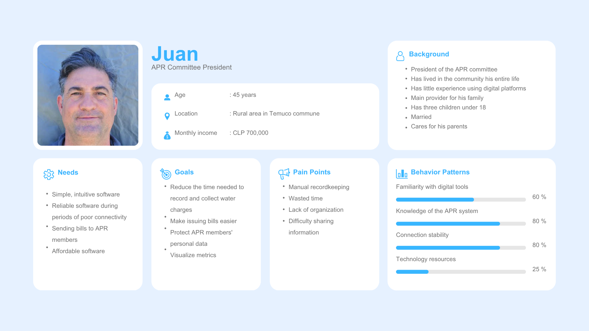

**Persona 2: Pedro** 

Pedro represents the elderly segment of the community; he is retired, has limited digital skills, and relies on younger family members for assistance. His greatest frustrations stem from his limited technology skills, difficulty seeing clearly, and a general distrust of digital systems. Furthermore, he struggles to navigate menus with many options. For Pedro, the system must provide simple software with technical support, ensuring strict privacy for his bills and payments.

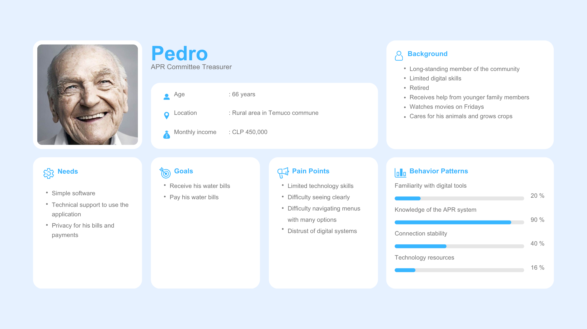

**Persona 3: Juana**

Holding a master's degree in Mathematical Civil Engineering, Juana represents users with high digital literacy. Her pain points revolve around the uncertainty of her bills, the difficulty in reporting errors to the committee leadership, and having little time to follow up on her water usage records. She requires simple, intuitive software that provides payment estimates and a quick way to report errors in water charges to save time.

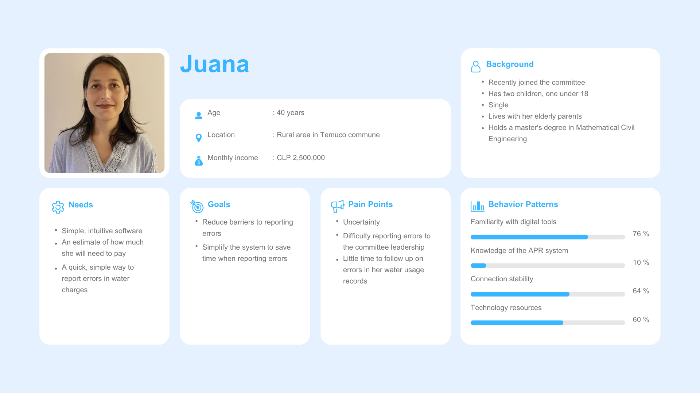

**Persona 4: Julio**

Julio has worked as the system operator for four years and directly faces the challenges of fieldwork. His main pain points are manual recordkeeping and wasted time. He needs simple and intuitive software that is reliable in areas with poor connectivity to allow for the quick and easy submission of meter readings. His broader goals include improving communication with the committee, making health recordkeeping easier, and receiving notifications about water supply interruptions.

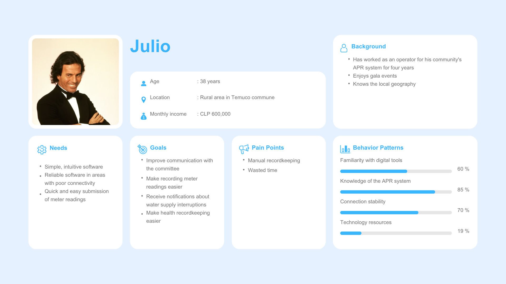

### 2.2. Value Proposition Canvas

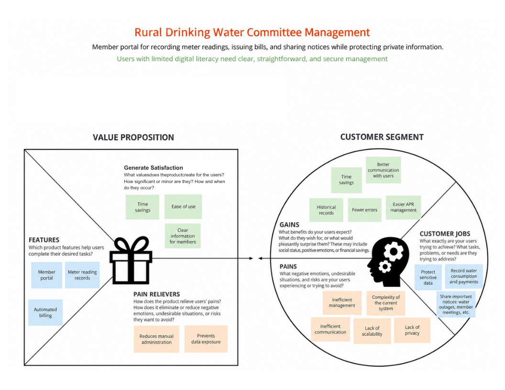

The "Value Proposition Canvas" ensured that the features of H2Organize directly address the frustrations of our Personas while delivering tangible benefits

**Customer Profile** 
- Customer Jobs: The users are trying to protect sensitive data, record water consumption and payments, and share important notices such as water outages or member meetings.
- Pains: Currently, users experience negative situations related to inefficient management and communication. They are heavily frustrated by the complexity of the current system, its lack of scalability, and a significant lack of privacy.
- Gains: Users expect and wish for time savings, the creation of historical records, and easier APR management. They also expect the system to produce fewer errors and provide better communication with users.

**Value Map** 
- Features To address the customer jobs, the product includes a member portal, meter reading records, and an automated billing system.
- Pain Relievers: The software directly relieves user frustrations because it reduces manual administration and preventes data exposure.
- Generate Satrisfaction: The product creates value and satisfaction by delivering significant time savings, ease of use, and clear information for members.

### 2.3. Customer Journey Map

The Customer Journey Map outlines the end-to-end experience of our primary users. Its purpose is to visualize their interactions with H2Organizer across different stages, from initially discovering the platform to daily operation and long-term loyalty. By mapping out their specific goals, touchpoints, and pain points at each step, this tool ensures our design strategy directly addresses their needs.

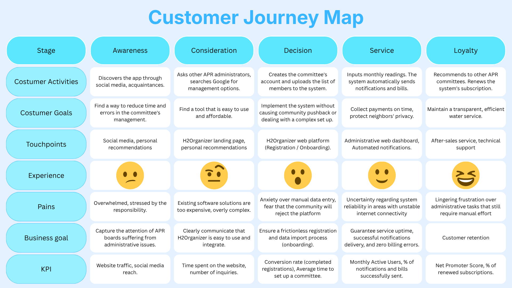

### 2.4. Benchmarking

UX benchmarking compares existing products to identify useful features and usability improvements. We analyzed **Sistema APR**, **ComunidadFeliz**, and **Banco Falabella** to guide H2Organize’s design.

Each platform provides a different perspective: rural water management, community administration, and clear financial interactions. Together, they help us understand how to simplify everyday tasks for our users.

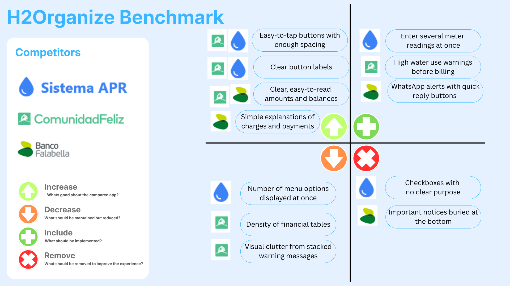

We summarized our findings in this image and included a detailed benchmark analysis [Benchmark.md](docs/Benchmark.md) to explain the observations behind our design decisions.

## 3. Structure

Building on the benchmark findings, H2Organize organizes navigation around each user's responsibilities and familiarity with technology. The committee needs a workspace to manage community information and payments, while operators need a practical interface for recording readings in the field.

For community members, even a simple menu may be a barrier. Their experience therefore begins with a personal WhatsApp link that provides access to payment and payment history without requiring a login.

### 3.1. Navigation Flow

The platform follows three main paths:

**Committee — Web interface:** After logging in, the committee accesses a dashboard with sections for members, readings, billing and payments, and incidents. Each section provides access to the information and actions needed to manage the community.
**Operator — Mobile and tablet interface:** After logging in, the operator finds a meter, enters its reading and any observations, saves the information, and continues to the next meter.
 **Member — Mobile payment:** A personal WhatsApp link opens "**Pagar mi cuenta**" directly. After a payment attempt, the member returns to **Resumen mensual**, which shows whether the payment succeeded and the remaining debt. From there, they can view their payment history or return to pay if a balance remains.

Each interface focuses on the tasks its users need to complete, keeping daily administration organized and the member's payment process easy to follow.

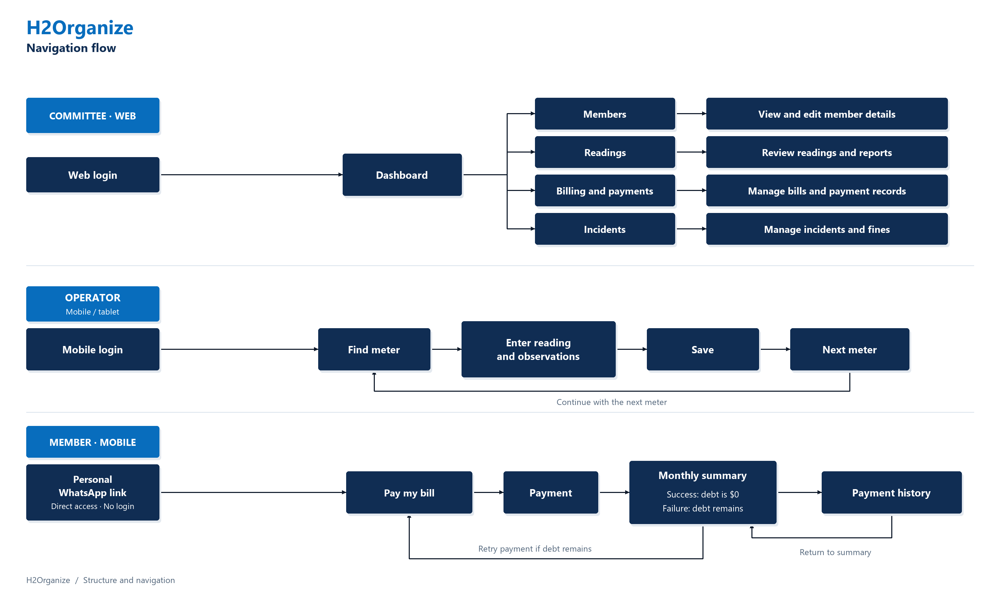

## 4. Layer Skeleton

**Interactive Figma Canvas:** [View Low-Fidelity Wireframes](https://www.figma.com/design/7bfLmHadeUUsBypPj2g5Yz/Wireframes?node-id=82-1493&t=Wbqk4IApEv1jXSIO-1)

Low-fidelity wireframes focused on layout distribution, information architecture, navigation flow, and functional hierarchy across the system modules.

### 4.1. Main Dashboard
**Function:** Centralize real-time global operational visibility for the APR committee.

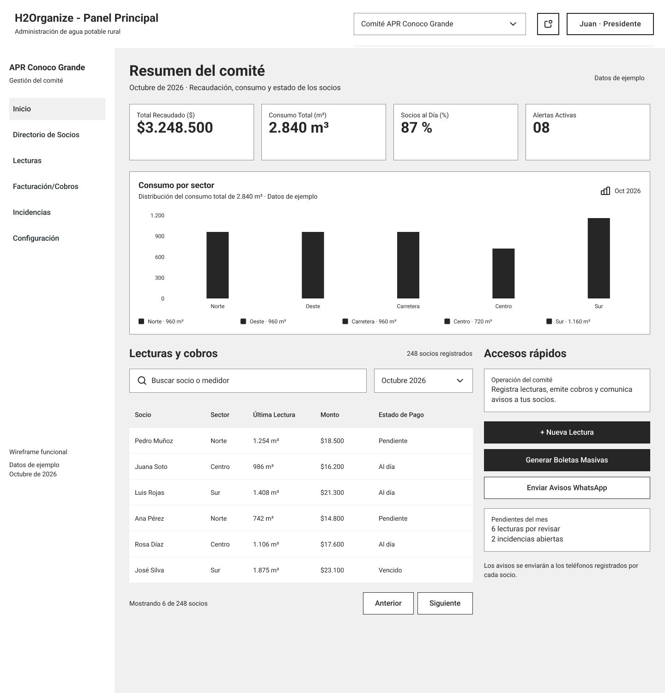

**Functional Description:** 
- Displays strategic KPIs at the top (total monthly collection, total accumulated consumption in m³, percentage of members up to date, and number of active alerts).
- Features an interactive consumption chart broken down by sector (North, West, Highway, Downtown, South) to identify demand anomalies by area.
- Provides a quick-access panel for frequent operational tasks (registering new readings, generating bulk bills, and sending WhatsApp notices).
- Includes a condensed reference table for quick lookup of members' operational and payment status.

### 4.2. Member Directory
**Function:** Manage the master registry of affiliated members and their financial/operational status.

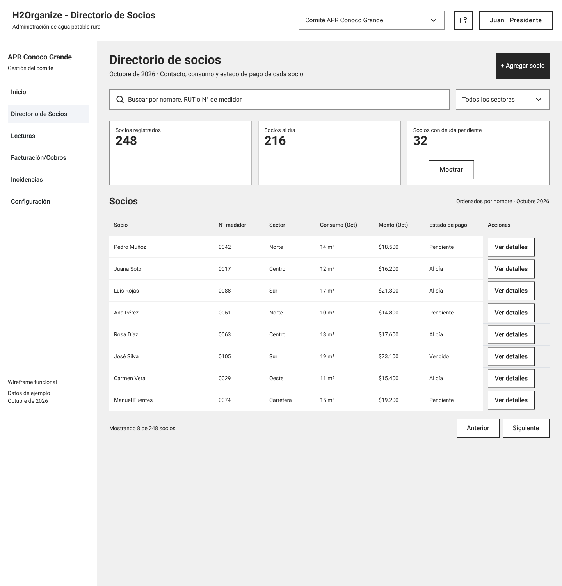

**Functional Description:** 
- Consolidates community status metrics (total registered members, members up to date, and members with pending debt).
- Provides filtering tools by geographic sector and search capabilities by name, RUT, or meter number.
- Displays a detailed data table with individual member information (Meter No., sector, monthly recorded consumption, billed amount, and payment status).
- Features direct row-level action buttons ("Ver detalles") and the primary "+ Agregar socio" entry point.

### 4.3. Meter Readings
**Function:** Monitor and manage the monthly field reading collection process.

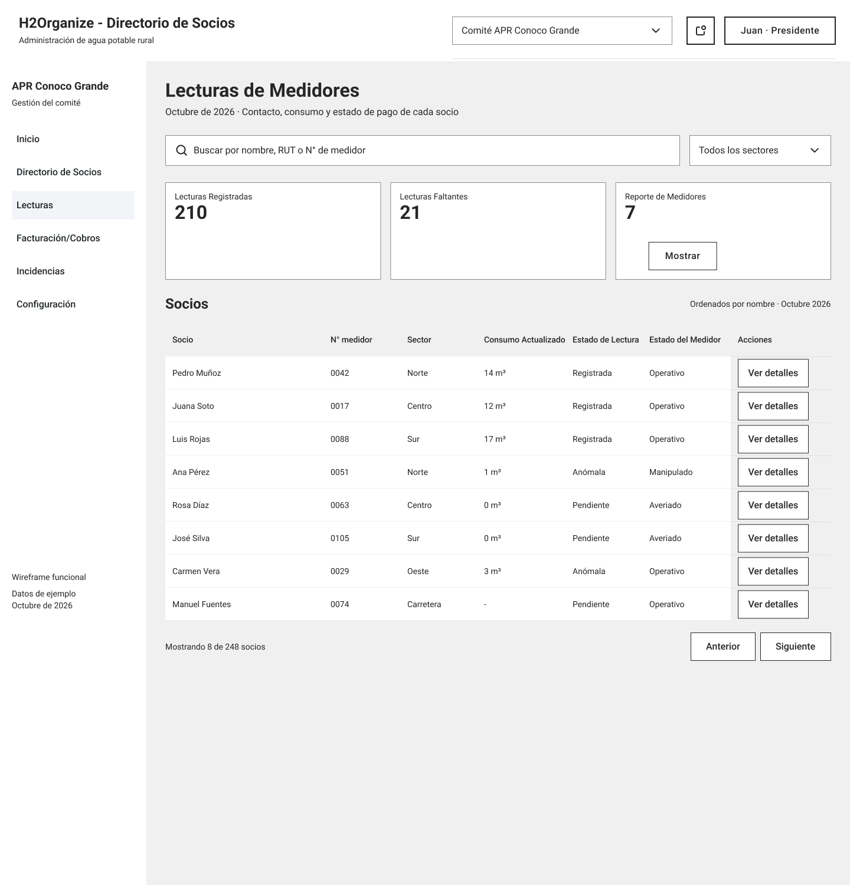

**Functional Description:** 
- Displays metrics tracking reading collection progress (recorded readings, pending readings, and issued reports).
- Integrates an operational control table with separate status fields: Reading Status ("Registrada", "Anómala", "Pendiente") and Meter Condition ("Operativo", "Manipulado", "Averiado").
- Enables early detection of physical or visual anomalies in meters prior to the billing process.

### 4.4. Billing and Collections
**Function:** Manage revenue collection, billing document issuance, and overdue account tracking.

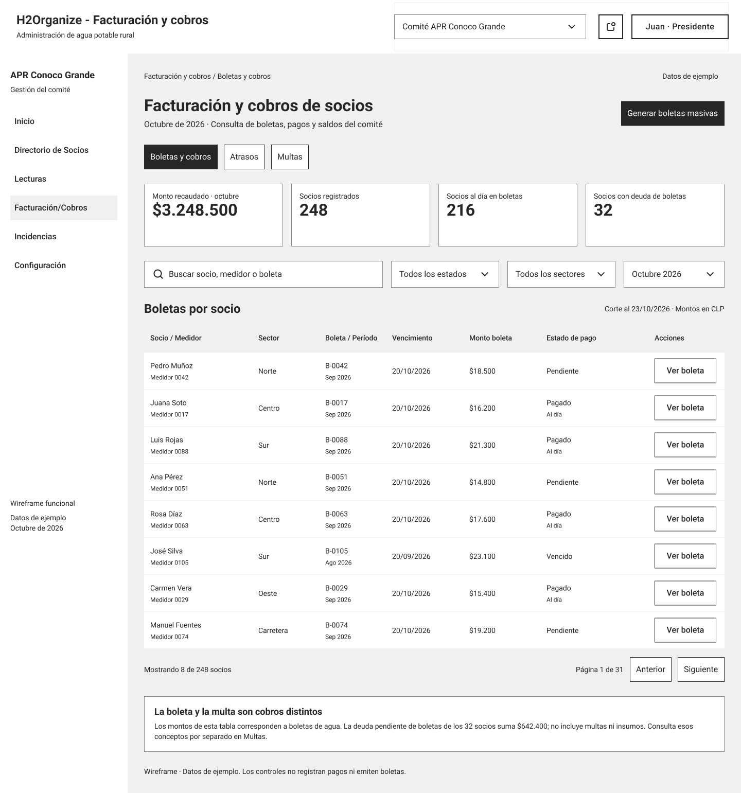

**Functional Description:** 
- Offers tabbed navigation (*Boletas y cobros*, *Atrasos*, *Multas*) to categorize different financial transaction types.
- Displays total monthly collections and the number of bills in pending, paid, or overdue status.
- Facilitates batch bill generation and individual balance breakdowns.
- Maintains a clear conceptual separation between regular water consumption bills and penalty charges applied via fines.

### 4.5. Issues and Reports
**Function:** Log, process, and track technical failures, equipment tampering, and operational irregularities.

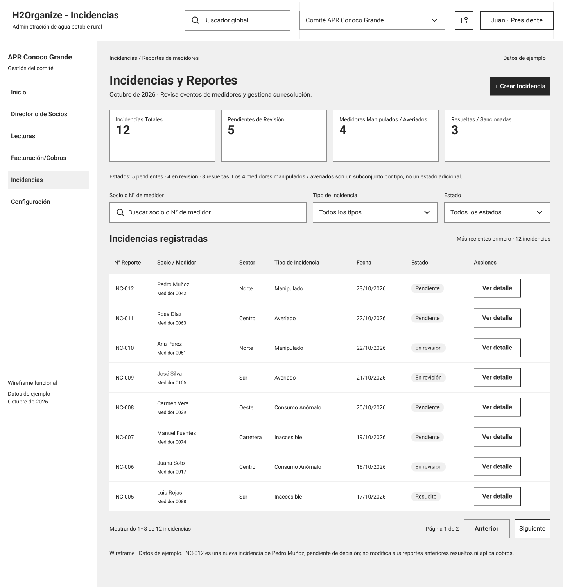

**Functional Description:** 
- Displays event management indicators (total issues, pending review, tampered/damaged meters, and resolved/penalized cases).
- Includes a filtering system by event type (*Manipulado, Averiado, Consumo Anómalo, Inaccesible*) and case status (*Pendiente, En revisión, Resuelto*).
- Lists logged issues with their unique report ID (`INC-XXX`), registration date, sector, and action buttons ("Ver detalle") to enable resolution or sanction workflows.
